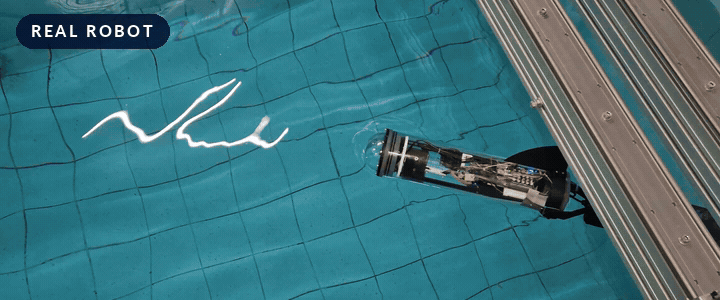
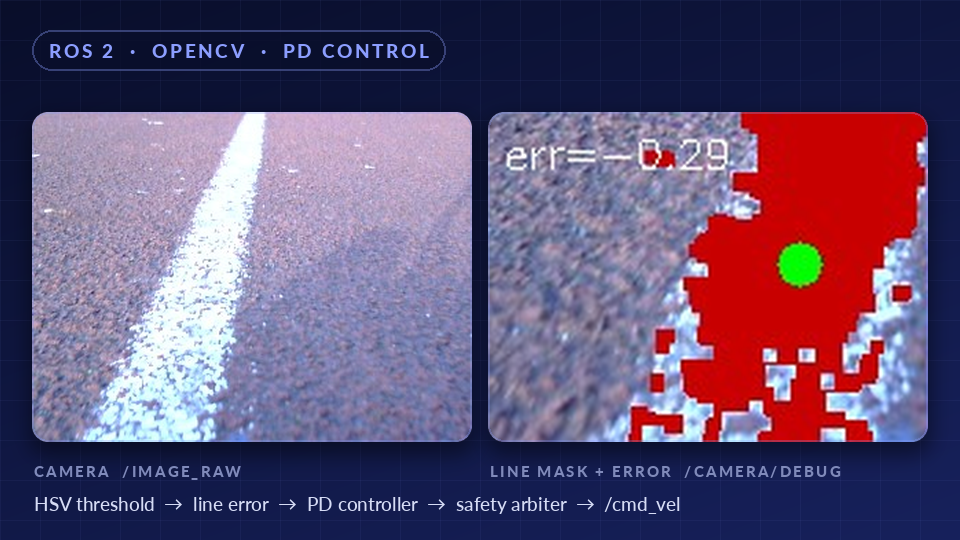
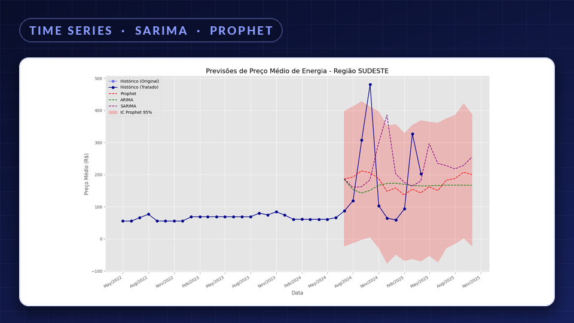
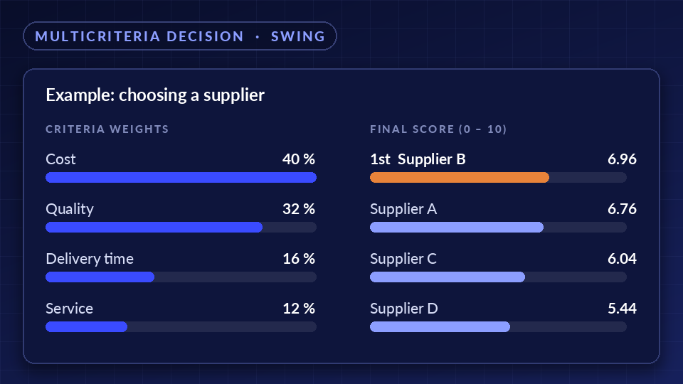
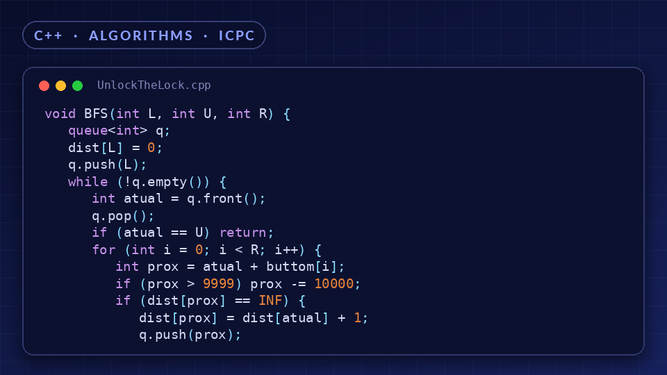

<picture>
  <source media="(prefers-color-scheme: dark)" srcset="assets/banner-dark.svg">
  <source media="(prefers-color-scheme: light)" srcset="assets/banner-light.svg">
  
</picture>

 

I work where software meets physics: modelling robots, estimating their state from imperfect sensors and controlling them, first in simulation and then on real hardware. My background combines autonomous robotics engineering at **ENSTA – Institut Polytechnique de Paris** and computer science at **UFSCar** (Federal University of São Carlos, Brazil).

 

## Featured project

### [Robot fish micro-AUV and its digital twin](https://github.com/pedrohaas/robot-fish-auv)

A bio-inspired underwater robot that swims by flapping its tail and dives with a sliding mass instead of a ballast, built by a team of six, together with the physics-based simulator used to develop its software before it goes into the water.

- **Physics, not animation:** buoyancy, hull and fin drag, and tail forces from Lighthill's slender-body theory. The thrust comes out of the model: about 0.7 m/s at 1.5 Hz.
- **Navigation, guidance and control on ROS 2:** sensor fusion (AHRS), dead reckoning, heading and depth control, and waypoint missions with a safe end.
- **Tested:** one codebase for the simulator and the robot, covered by 153 automated tests.

`Unity` `C#` `ROS 2` `Python` `Onshape` · [Repository](https://github.com/pedrohaas/robot-fish-auv) · [Simulator download](https://github.com/pedrohaas/robot-fish-auv/releases/latest)

 

## Selected projects

<table>
  <tr>
    <td width="50%" valign="top">
      
        
      <b><a href="https://github.com/pedrohaas/FollowLine-Robot-Algorithm">Line-following robot car</a></b>
       
      ROS 2 on a Raspberry Pi 4: an OpenCV pipeline turns the camera image into a line error, a PD controller steers, and a safety arbiter node keeps teleoperation in command. Every run is logged in MCAP and analysed automatically.
    </td>
    <td width="50%" valign="top">
      
        
      <b><a href="https://github.com/pedrohaas/Analise-Preditiva-Energia">Energy market forecasting dashboard</a></b> · <a href="https://pedrohaas.github.io/Analise-Preditiva-Energia/">live demo</a>
       
      Forecasts of Brazilian energy prices (SARIMA, Prophet) combined with a decision tree, to choose how a sugarcane mill should collect its straw to generate and sell electricity.
    </td>
  </tr>
  <tr>
    <td width="50%" valign="top">
      
        
      <b><a href="https://github.com/pedrohaas/matriz-de-preferencia">Preference Matrix</a></b> · <a href="https://matriz-de-preferencia.vercel.app/">live demo</a>
       
      A web tool that guides multicriteria decisions step by step: criteria, alternatives, anchor-based scoring and weight elicitation (Swing, Rank-Sum), with dominance and sensitivity checks.
    </td>
    <td width="50%" valign="top">
      
        
      <b><a href="https://github.com/pedrohaas/Exercicios-Codeforces">Competitive programming</a></b>
       
      Algorithm and data structure problems solved in C++ while training for the ICPC (qualified for the Brazilian Finals).
    </td>
  </tr>
</table>

 

## Beyond GitHub

| Project | What it involved |
| --- | --- |
| **Stewart platform control** Research internship · ROBEX team, ENSTA | Passivity-based controller for a 6-DOF Stewart platform for active heave compensation, with a Lyapunov stability analysis that keeps the loop stable under sensor and actuator delays. CAD digital twin in Onshape, simulation in MATLAB. |
| **Autonomous robotic boats** Team project · DDBOAT, Lake Guerlédan | GPS waypoint navigation, least-squares magnetometer calibration for the heading, and synchronized missions of a multi-boat swarm. |
| **AGRI-Scout** Team project · built from scratch | Autonomous mobile robot (ROS 2, STM32, Python) that combines computer vision with moisture and temperature sensing into a decision-support prototype for local farmers. |
| **Obstacle-crossing ground robot** Team project · ENSTA | My part: ROS 2 nodes for the LiDAR and the GNSS receiver, the RGB-D camera node (with a teammate), the URDF model of the robot, and fixes to the EKF that fuses IMU, LiDAR odometry and GNSS. |
| **Payment terminal simulator** Internship · C6 Bank | Object-oriented C# simulator of Ingenico terminals that generates and validates ISO 8583 card messages and PIX QR code payments, checked against the company's validator suite. |

 

## Publication

**What Do You Really Mean? Automatically Simplifying Sarcasm and Lexical Ambiguity to Enhance Text Accessibility** 
*Intelligent Systems (BRACIS 2026)*, Lecture Notes in Computer Science, Springer. 
[Read the chapter](https://link.springer.com/chapter/10.1007/978-3-032-39904-5_27) · [Evaluation web app](https://github.com/pedrohaas/WhatDoYouReallyMean-DataColectWebsite)

 

## Capabilities

| Control and estimation | Robotics software | Simulation and modelling | AI and data |
| --- | --- | --- | --- |
| PID, passivity-based control, Lyapunov analysis, Kalman filters, least squares | ROS 2, sensor fusion, navigation, embedded systems (STM32, Raspberry Pi) | Unity, MATLAB/Simulink, physics-based modelling, CAD (Onshape) | Computer vision, machine learning, NLP, time-series forecasting |

**Languages:** C++ · C · Python · C# · JavaScript · SQL · MATLAB  
**Tools:** Git · Docker · Linux

 

## Background

**ENSTA – Institut Polytechnique de Paris** · Engineering degree (Diplôme d'ingénieur), Autonomous Robotics 
**UFSCar – Federal University of São Carlos** · Bachelor of Computer Science, with undergraduate research in natural language processing 
Double degree · CAPES–BRAFITEC merit scholarship · ICPC Brazilian Finals qualifier · Instructor at the UFSCar competitive programming club

**Spoken languages:** Portuguese (native) · English (fluent, TOEIC 920/990) · French (B2)

 

<picture>
  <source media="(prefers-color-scheme: dark)" srcset="assets/footer-dark.svg">
  <source media="(prefers-color-scheme: light)" srcset="assets/footer-light.svg">
  
</picture>
